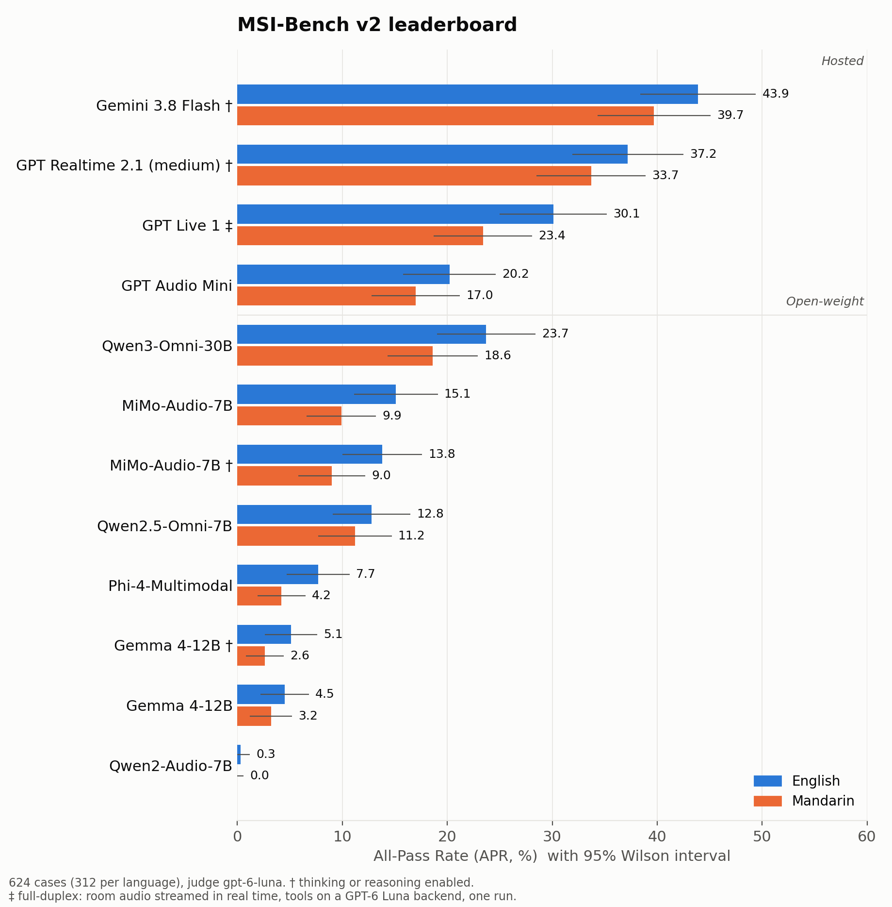
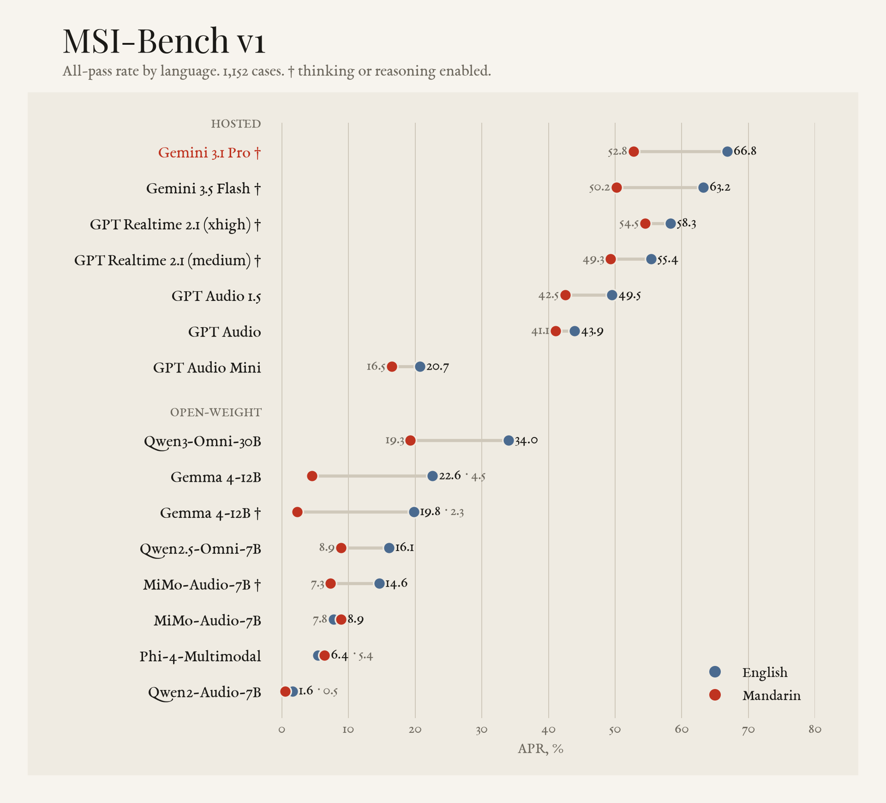

<h1 align="center">MSI-Bench</h1>

<p align="center">
  <a href="https://arxiv.org/abs/2609.24812"></a>
  <a href="https://huggingface.co/datasets/M2cha4l1124/MSI-Bench"></a>
  <a href="LICENSE"></a>
  <a href="https://boson-ai.github.io/MSI-Bench/"></a>
</p>

## Updates

- **2026-11-18** v2 leaderboard: GPT Live 1 added (full-duplex streaming protocol, see the v2 results table). v2 tool-call scoring now ignores a call to a read-only tool that the gold does not require; the dataset lists those tools per case in `eval.tool_validation.read_only_call_names`. Existing v2 APR moves by at most 0.3.
- **2026-11-12** MSI-Bench v2 released: 624 cases, 2 to 4 speakers, a full-duplex floor layer and real room acoustics. Published under `v2/` on the [HuggingFace dataset](https://huggingface.co/datasets/M2cha4l1124/MSI-Bench/tree/main/v2) (CC BY-NC 4.0). v1 stays at the dataset root.
- **2026-09-21** MSI-Bench v1 released with the paper ([arXiv:2609.24812](https://arxiv.org/abs/2609.24812)): 1,152 cases, 2 or 3 speakers (CC BY 4.0).

> [!WARNING]
> **v1 and v2 scores are not comparable.** v2 has different cases, longer multi-speaker room audio, a different answer protocol and a different judge. Report them separately and always name the version.

Evaluation code for **MSI-Bench** (Multi-Speaker Interaction Benchmark): the
prediction runners, deterministic scoring, LLM answer judge, and the table
aggregation used in the paper *MSI-Bench: Evaluating Multi-Speaker Voice
Interaction for Collaborative AI Agents*.

MSI-Bench tests whether a voice assistant in a multi-speaker conversation can
track who said what, to whom it applies, and who may change it, and then take
the correct next action: answer, call a tool, refuse, ask, or stay silent. It
has 1,152 base test cases over 8 behavior settings
and 6 patterns, with 2 or 3 human speakers per case. **MSI-Bench v2** (624
cases, 2 to 4 speakers, full-duplex floor layer, real room acoustics) is
published; see
[What's new in v2](#whats-new-in-v2).

## Leaderboard

**v1 and v2 scores are not comparable**: different cases, audio, protocol and judge. Each chart stands on its own.

<p align="center"></p>

v2: 624 cases, English and Mandarin APR per model, judge gpt-6-luna. Full
columns (ARS, Tool, per-pattern APR) are in the v2 results table below.

<p align="center"></p>

v1: 1,152 cases, results from the paper. † marks thinking or reasoning enabled.

<details>
<summary>v1 results tables (English, Mandarin)</summary>

English results from the paper. APR has a 95% Wilson interval. Bold marks the
best hosted and the best open-weight result per column. † marks reasoning or
thinking enabled. ‡ marks configurations affected by output-format errors.
"–" means the probe was not run or the model produced no valid prediction.

| Model | APR | ARS | Tool | BIR ↑ | PRR ↓ | Auth. | Discl. | Prior. | Seq. | Scope | Retr. |
| --- | --- | --- | --- | --- | --- | --- | --- | --- | --- | --- | --- |
| *Hosted* | | | | | | | | | | | |
| Gemini 3.1 Pro † | **66.8 ±3.8** | **78.0** | **58.8** | **86.5** | **21.5** | 76.0 | **85.4** | 69.8 | **77.1** | 72.9 | **19.8** |
| Gemini 3.5 Flash † | 63.2 ±3.9 | 73.6 | 55.5 | 74.9 | 48.2 | 79.2 | 67.7 | **77.1** | 71.9 | **74.0** | 9.4 |
| GPT Realtime 2.1 (xhigh) † | 58.3 ±4.0 | 73.7 | 44.8 | 83.6 | 28.1 | **86.5** | 82.3 | 70.8 | 51.0 | 50.0 | 9.4 |
| GPT Realtime 2.1 (medium) † | 55.4 ±4.0 | 70.1 | 41.8 | 81.5 | 35.6 | 81.3 | 83.3 | 68.8 | 41.7 | 43.8 | 13.5 |
| GPT Audio 1.5 | 49.5 ±4.1 | 64.4 | 40.3 | 70.2 | 52.4 | 78.1 | 63.5 | 55.2 | 47.9 | 37.5 | 14.6 |
| GPT Audio | 43.9 ±4.0 | 61.5 | 41.8 | 64.1 | 62.8 | 66.7 | 54.2 | 50.0 | 44.8 | 33.3 | 14.6 |
| GPT Audio Mini | 20.7 ±3.3 | 40.0 | 26.3 | – | 97.9 | 30.2 | 11.5 | 38.5 | 20.8 | 15.6 | 7.3 |
| *Open-weight* | | | | | | | | | | | |
| Qwen3-Omni-30B | **34.0 ±3.9** | **53.3** | **26.5** | 43.6 | 92.2 | **63.5** | **57.3** | **33.3** | **27.1** | **15.6** | **7.3** |
| Gemma 4-12B | 22.6 ±3.4 | 43.9 | 20.0 | 57.5 | 85.9 | 42.7 | 38.5 | 26.0 | 12.5 | 13.5 | 2.1 |
| Gemma 4-12B † | 19.8 ±3.2 | 41.3 | 18.3 | **60.9** | **66.1** | 37.5 | 33.3 | 24.0 | 10.4 | 11.5 | 2.1 |
| Qwen2.5-Omni-7B | 16.1 ±3.0 | 38.2 | 10.0 | – | 100.0 | 30.2 | 43.8 | 15.6 | 2.1 | 3.1 | 2.1 |
| MiMo-Audio-7B † ‡ | 14.6 ±2.9 | 33.4 | 6.0 | – | 86.6 | 39.6 | 33.3 | 11.5 | 2.1 | 1.0 | 0.0 |
| MiMo-Audio-7B ‡ | 7.8 ±2.2 | 24.6 | 8.3 | – | 98.8 | 21.9 | 5.2 | 11.5 | 4.2 | 2.1 | 2.1 |
| Phi-4-Multimodal | 5.4 ±1.9 | 32.0 | 0.0 | – | 100.0 | 0.0 | 32.3 | 0.0 | 0.0 | 0.0 | 0.0 |
| Qwen2-Audio-7B | 1.6 ±1.1 | 11.8 | 0.0 | – | 5.7 | 0.0 | 9.4 | 0.0 | 0.0 | 0.0 | 0.0 |

**Mandarin**

| Model | APR | ARS | Tool | BIR ↑ | PRR ↓ | Auth. | Discl. | Prior. | Seq. | Scope | Retr. |
| --- | --- | --- | --- | --- | --- | --- | --- | --- | --- | --- | --- |
| *Hosted* | | | | | | | | | | | |
| Gemini 3.1 Pro † | 52.8 | 69.9 | **58.8** | **74.6** | **32.5** | 80.2 | 53.1 | 51.0 | **71.9** | 59.4 | 1.0 |
| Gemini 3.5 Flash † | 50.2 | 67.5 | **58.8** | 67.4 | 74.9 | 81.3 | 35.4 | **58.3** | 64.6 | **61.5** | 0.0 |
| GPT Realtime 2.1 (xhigh) † | **54.5** | **76.4** | 54.1 | – | 37.8 | **87.5** | **71.9** | **58.3** | 51.0 | 56.3 | 2.1 |
| GPT Realtime 2.1 (medium) † | 49.3 | 70.2 | 47.6 | – | 43.1 | 85.4 | 67.7 | 51.0 | 44.8 | 44.8 | 2.1 |
| GPT Audio 1.5 | 42.5 | 59.6 | 51.0 | 53.3 | 70.2 | 67.7 | 39.6 | 46.9 | 51.0 | 45.8 | **4.2** |
| GPT Audio | 41.1 | 60.1 | 46.5 | 60.9 | 80.6 | 74.0 | 39.6 | 49.0 | 44.8 | 35.4 | **4.2** |
| GPT Audio Mini | 16.5 | 36.6 | 22.7 | – | 97.9 | 27.1 | 20.8 | 27.1 | 7.3 | 15.6 | 1.0 |
| *Open-weight* | | | | | | | | | | | |
| Qwen3-Omni-30B | **19.3** | **41.8** | **26.3** | 43.3 | 99.5 | **28.1** | 19.8 | **35.4** | **17.7** | **11.5** | **3.1** |
| Gemma 4-12B | 4.5 | 28.3 | 0.0 | **60.0** | 92.6 | 0.0 | 27.1 | 0.0 | 0.0 | 0.0 | 0.0 |
| Gemma 4-12B † | 2.3 | 16.7 | 0.0 | 45.5 | **39.3** | 0.0 | 13.5 | 0.0 | 0.0 | 0.0 | 0.0 |
| Qwen2.5-Omni-7B | 8.9 | 33.8 | 10.9 | – | 100.0 | 16.7 | 16.7 | 13.5 | 0.0 | 5.2 | 1.0 |
| MiMo-Audio-7B † ‡ | 7.3 | 23.5 | 3.4 | – | – | 17.7 | 18.8 | 5.2 | 1.0 | 0.0 | 1.0 |
| MiMo-Audio-7B ‡ | 8.9 | 35.8 | 3.9 | – | – | 22.9 | 22.9 | 5.2 | 0.0 | 1.0 | 1.0 |
| Phi-4-Multimodal | 6.4 | 33.7 | 0.3 | – | 99.5 | 1.0 | **36.5** | 1.0 | 0.0 | 0.0 | 0.0 |
| Qwen2-Audio-7B | 0.5 | 12.4 | 0.0 | – | 0.0 | 0.0 | 3.1 | 0.0 | 0.0 | 0.0 | 0.0 |


</details>

<details>
<summary>v2 results table (624 cases, judge gpt-6-luna)</summary>

| Model | APR (±95%) | ARS | Tool | Format errors | Auth. | Discl. | Prior. | Seq. | Scope | Retr. |
| --- | --- | --- | --- | --- | --- | --- | --- | --- | --- | --- |
| Gemini 3.8 Flash † | 41.8 ±3.9 | 60.9 | 45.3 | 0 | 51.0 | 80.8 | 52.9 | 26.0 | 20.2 | 20.2 |
| GPT Realtime 2.1 (medium) † | 35.4 ±3.7 | 57.2 | 38.3 | 0 | 51.0 | 68.3 | 52.9 | 9.6 | 20.2 | 10.6 |
| GPT Live 1 ‡ | 26.8 ±3.5 | 50.5 | 30.2 | 0 | 39.4 | 69.2 | 42.3 | 2.9 | 4.8 | 1.9 |
| Qwen3-Omni-30B | 21.2 ±3.2 | 41.5 | 22.4 | 39 | 33.7 | 56.7 | 23.1 | 2.9 | 0.0 | 10.6 |
| GPT Audio Mini | 18.6 ±3.0 | 39.7 | 21.6 | 0 | 34.6 | 48.1 | 23.1 | 1.0 | 1.0 | 3.8 |
| MiMo-Audio-7B | 12.5 ±2.6 | 35.6 | 11.6 | 15 | 23.1 | 41.3 | 8.7 | 0.0 | 0.0 | 1.9 |
| Qwen2.5-Omni-7B | 12.0 ±2.6 | 33.1 | 12.4 | 39 | 24.0 | 36.5 | 5.8 | 1.9 | 0.0 | 3.8 |
| MiMo-Audio-7B † | 11.4 ±2.5 | 34.6 | 11.3 | 48 | 20.2 | 33.7 | 13.5 | 0.0 | 0.0 | 1.0 |
| Phi-4-Multimodal | 5.9 ±1.9 | 34.8 | 1.1 | 12 | 9.6 | 25.0 | 1.0 | 0.0 | 0.0 | 0.0 |
| Gemma 4-12B | 3.8 ±1.5 | 23.7 | 1.1 | 2 | 4.8 | 17.3 | 1.0 | 0.0 | 0.0 | 0.0 |
| Gemma 4-12B † | 3.8 ±1.5 | 22.2 | 1.6 | 0 | 2.9 | 18.3 | 1.0 | 0.0 | 0.0 | 1.0 |
| Qwen2-Audio-7B | 0.2 ±0.4 | 14.4 | 0.0 | 0 | 0.0 | 1.0 | 0.0 | 0.0 | 0.0 | 0.0 |

Protocol: Gemini and GPT Audio through native tool calling (Gemini with its
default thinking), GPT Realtime through the Realtime API with reasoning effort
medium, open-weight models through vLLM with schema-constrained decoding
(`IB_LOCAL_GUIDED_JSON=1`); one audio message per room block, earlier assistant
replies as text; judge gpt-6-luna. † thinking or reasoning enabled. Format
errors are cases with no parseable prediction (counted as failures).

‡ GPT Live 1 (`gpt-live-1`) is full-duplex and takes no pre-cut turns. Each
case's room audio is streamed in real time on the recorded timeline and the
model decides when to speak. Tools sit on a GPT-6 Luna backend (Responses
delegation); every function call is answered "accepted, not completed". The
scored answer is what the model says from the start of the last target line;
the scored tool calls are those of the whole session. One run.

Tool calls (all models): a call to a tool listed in the case's
`eval.tool_validation.read_only_call_names` is ignored when the gold does not
require it, by the validator and by the judge. Every other call must match
the gold exactly.

</details>

**Metrics** (all in %):

- **APR** (All-Pass Rate): cases that pass every atomic rubric.
- **ARS** (Atomic Rubric Score): atomic rubrics passed, pooled over cases.
- **Tool**: strict pass rate on cases that need a tool call (names, count,
  arguments, ownership, no extra calls).
- **BIR** (Bystander Interference Robustness): answers that still pass after
  an unrelated human-to-human utterance plays while the assistant answers.
- **PRR** (Premature Response Rate): truncated cases where the assistant
  speaks before anyone addresses it. Lower is better. Qwen2-Audio-7B's low PRR
  comes from near-total silence, not from good turn-taking.
- **Patterns**: Auth. = speaker authority constraint, Discl. = selective
  disclosure, Prior. = constraint prioritization, Seq. = sequential constraint
  integration, Scope = scope tracking, Retr. = background speech retrieval.

## What's new in v2

MSI-Bench v2 keeps the six interaction patterns of v1 and rebuilds the audio
around what a room-scale assistant actually hears. 624 cases, two languages.

**A full-duplex floor layer.** Backchannels ("mm-hm", "right"),
interruptions, cut-off sentences, failed attempts to take the floor, and the
assistant's own backchannels in the heard mix. Earlier assistant replies are
part of the room audio history, in the assistant's own voice. About a third of
the cases add an unrelated background conversation between people who are not
part of the task; those voices take their own speaker labels, so the model has
to tell who is talking to it.

**Real room acoustics .** Instead of DSP reverb, we use room impulse responses (RIRs) to render the audio, so that each sound carries the reflections, reverberation and coloration of a real physical space.

**Five times the voices, three times the ambiences.** 480 cloned Common Voice
voices and 249 Freesound ambience recordings. Every ambience
excerpt had its foreground speech removed with a source-separation model
(BS-RoFormer vocal stem subtraction) before mixing, so the only voices in a case
are the ones the case puts there.

**Fewer cases, more coverage, cheaper to run.** 624 cases instead of 1,152. At
equal sample size v2 uses 4 to 5 times as many voices, 2.7 times as many
ambiences, and its individual utterances are more semantically diverse (Vendi
score), so a run represents more conditions for roughly half the audio.

**Tools the way models see them today.** Tool definitions ship in Anthropic
`input_schema` form together with the system prompt used at generation time.
In the scope-tracking and sequential-constraint patterns, gold tool calls bind
each constraint to its owner by voice label (`<|S1|>`, `<|S2|>`, …, numbered in
order of first appearance), so speaker attribution is scored inside the tool
call itself.

## Layout

- `src/ib/`: the `ib` CLI. `ib eval` generates predictions, validates tool calls
  (`manifest_eval.json`), runs the answer judge and writes one target directory per
  model; `ib answer-judge` re-judges an existing `predictions.jsonl`.
- `configs/`: eval target files for `ib eval --models`. `configs/eval-targets/<target>.yaml`
  holds one file per published target (hosted and open-weight); `configs/eval-*.yaml` are
  the v1 rosters.
- `serve/`: vLLM settings for the open-weight models; see [serve/README.md](serve/README.md).
- `tools/`:
  - `build_suite_from_release.py`: v1 release package to an `ib eval` suite
  - `build_suite_from_release_v2.py`: v2 release package to an `ib eval` suite
  - `paper_table_rows.py`: folds `ib eval` outputs into the table columns (v1 and v2)
  - `label_tool_side_effects.py`, `stamp_read_only_tools.py`,
    `data/tool_side_effects_v2.jsonl`: how the v2 read-only tool names were labelled and
    stamped (already stamped in the published v2 package; rerunning is optional)
- `tests/`: unit tests for the shipped code (`uv run pytest`).

## Quick start

```bash
uv sync --extra gemini        # or: pip install -e ".[gemini]"
cp .env.example .env          # fill in the provider keys you need
```

**v2** (download `v2/` of the Hugging Face dataset):

```bash
python tools/build_suite_from_release_v2.py --release <msi-bench-v2 dir> --output suite-v2/
ib eval --run suite-v2/ --models configs/eval-targets/gpt-audio-mini.yaml --output artifacts/eval/v2 \
    --answer-judge --judge-provider openrouter --judge-model openai/gpt-6-luna
python tools/paper_table_rows.py --suite suite-v2/ --runs artifacts/eval/v2
```

**v1** (download the v1 package):

```bash
python tools/build_suite_from_release.py --release <msi-bench-v1 dir> --output suite-v1/ --probes
ib eval --run suite-v1/ --models configs/eval-models.yaml --output artifacts/eval/v1 \
    --answer-judge --judge-provider openrouter --judge-model deepseek/deepseek-v4-pro
python tools/paper_table_rows.py --suite suite-v1/ --runs artifacts/eval/v1
```

Each adapter writes one `<entry>/manifest/manifest.jsonl` (plus `plans/rubrics.jsonl`)
per (language, pattern); audio paths point into the release package. `ib eval` writes
`generated/<mode>/.../<model>[/<variant>]/` with `predictions.jsonl`,
`manifest_eval.json` and `answer_judge.json`. Add `--limit N` to try a few cases first.

## Setup prompts: v1 and v2

v1 and v2 send the evaluated model different setup (system) prompts, each the one its
published numbers were produced with. Every suite row carries `prompt_version`, written
by the adapter: `"v1"` from `build_suite_from_release.py`, `"v2"` from
`build_suite_from_release_v2.py`. `ib eval` picks the prompt from that field; any other
value is an error. A v1 suite built before the field existed is still read as v1 (its
case ids are recognised).

- **v1 prompt:** an authorization-policy block, the scene's assistant role, and for
  prompt-JSON targets a compact function list (`name arguments: field: type`).
- **v2 prompt:** the assistant's name, how voice labels `<|S1|>`, `<|S2|>`, ... number the
  voices, and for prompt-JSON targets the case's Anthropic tool definitions.

The GPT Realtime output cap also follows the version: 700 tokens for reasoning effort
medium in v1, 4096 in v2 (4096 for xhigh in both).

## Reproducing v2

- **Suite:** `tools/build_suite_from_release_v2.py`, base rows only. v2 has no hear-time
  or speak-time probes, so leave out `--probes`, `--case-modes`, `--live-probe` and
  `--speak-probe-approx`.
- **Judge:** `--answer-judge --judge-provider openrouter --judge-model openai/gpt-6-luna`
  (`OPENROUTER_API_KEY`).
- **Hosted models:** native tool calling. `configs/eval-targets/gpt-audio-mini.yaml`
  (OpenAI Chat Completions) and `configs/eval-targets/gemini-3.8-flash.yaml` (the API's
  default thinking) send each case's tools as provider function declarations.
  `configs/eval-targets/gpt-realtime-2.1-medium.yaml` runs the Realtime API with reasoning
  effort medium; the decision comes back through an `emit_prediction` function call.
- **Open-weight models:** served with vLLM ([serve/README.md](serve/README.md)) and
  evaluated through the `local` provider with schema-constrained decoding:
  `export IB_LOCAL_GUIDED_JSON=1` before `ib eval`. One target file per table row:
  `qwen3-omni-instruct`, `qwen2.5-omni`, `qwen2-audio`, `phi4-multimodal`, `gemma4-12b`
  (both Gemma 4 rows), `mimo-audio` (thinking) and `mimo-audio-plain`.
- **History:** one audio message per room block, earlier assistant replies as text, from
  the case's `audio_history`.
- **Tool calls:** a call to a tool in the case's
  `eval.tool_validation.read_only_call_names` is ignored when the gold does not require
  it, by the deterministic validator and by the judge. Every other call must match the
  gold exactly.
- **Table:** `tools/paper_table_rows.py --suite <suite> --runs <eval dir>` prints APR
  (95% Wilson half-width), ARS, Tool, format errors and per-pattern APR. BIR and PRR
  print `--` for v2.

## Reproducing v1 (the paper setting)

- **Suite:** `tools/build_suite_from_release.py --probes`.
- **Judge:** DeepSeek V4 Pro through OpenRouter, JSON mode, provider default
  temperature (`--answer-judge --judge-provider openrouter --judge-model
  deepseek/deepseek-v4-pro`, `OPENROUTER_API_KEY` in `.env`).
- **Open-weight models:** served with vLLM ([serve/README.md](serve/README.md)),
  evaluated through the `local` provider with schema-constrained decoding:
  `export IB_LOCAL_GUIDED_JSON=1` before `ib eval`. Thinking variants (Gemma 4,
  MiMo-Audio) are declared in the matching `configs/eval-targets/*.yaml`.
- **Hosted models:** `openai` (GPT Audio), `openai_realtime` (GPT Realtime),
  `gemini` providers; see `configs/eval-models.yaml` and `configs/eval-targets/`.
- **Probes:** hear-time probes (PRR) run on every target (`--case-modes base,hear`).
  Speak-time probes (BIR) run natively on full-duplex targets with `--live-probe`, and on
  turn-based targets through the barge-in approximation `--speak-probe-approx`.
- **Metrics:** `tools/paper_table_rows.py` prints APR (with 95% Wilson half-width), ARS,
  Tool, BIR, PRR and per-pattern APR per target, with the paper's policies (format errors
  fail every atom; PRR excludes format-error rows; Tool over cases requiring a call).

## Output format expected from a model

Prompt-JSON targets (open-weight models, and GPT Realtime through its `emit_prediction`
function) return one JSON object per case:

```json
{"predicted_action": "respond" | "silent", "answer_text": "...",
 "tool_calls": [{"name": "...", "arguments": {...}}]}
```

Native-tool targets (GPT Audio, Gemini) return their tool calls through the provider's
function calling, and the respond/silent decision with the answer text as the JSON object
above (with `tool_calls` empty) in the text channel.

## License

MIT — see [LICENSE](LICENSE).
